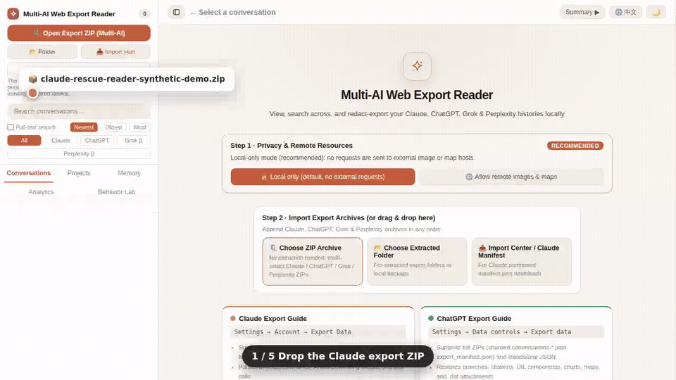

[中文](README.md) | [English](README.en.md)

# Multi-AI Web Export Reader

**A local-only Multi-AI Export History Viewer — Claude · ChatGPT · Grok (Beta) · Perplexity (Beta)**

Turn official export ZIPs, extracted folders, or standalone JSON from major AI platforms into a unified local workspace for reading, cross-platform search, analytics, and privacy-safe redaction.

> 🔒 **Local-only · Zero uploads · No backend**: All parsing, search, analytics, and redaction run inside your browser. Remote images and map tiles are **off by default** (toggleable in Step 1 or the header); the offline bundle works completely without network access.

[](https://github.com/Artistkisa/claude-rescue-reader/releases/latest)
[](https://github.com/Artistkisa/claude-rescue-reader/actions/workflows/viewer-validation.yml)
[](https://github.com/Artistkisa/claude-rescue-reader/actions/workflows/browser-smoke.yml)
[](https://github.com/Artistkisa/claude-rescue-reader/actions/workflows/privacy-guard.yml)
[](https://github.com/Artistkisa/claude-rescue-reader/releases/latest)
[](LICENSE)

**[⬇ Download `viewer.html`](https://github.com/Artistkisa/claude-rescue-reader/releases/latest/download/viewer.html)** · **[🔌 Download offline bundle](https://github.com/Artistkisa/claude-rescue-reader/releases/latest/download/claude-rescue-reader-offline.zip)** · **[🧪 Synthetic demo ZIP](docs/demo/claude-rescue-reader-synthetic-demo.zip)** · **[🌐 中文](README.md)**


<sub>Screenshot generated from the fictional “Beichen Coffee Subscription” archive; every person, brand, file, and metric is synthetic.</sub>

---

## Supported AI Platforms

Append archives from multiple platforms into the **same workspace in any order** — accounts stay isolated per platform, with unified filtering, search, and cross-platform analytics:

| Platform | Status | Export Path | Supported Formats & Features | Docs |
|---|---|---|---|---|
| **Claude** | Stable | `Settings → Account → Export Data` | Partitioned `manifest-*.json` + ZIPs, legacy ZIP/folder; branches, Thinking states, tool calls, Artifact version history, Projects with 3-layer inference, global/project memories, Design, account & login history | [Partitioned Import Guide](docs/new-export-import.md) |
| **ChatGPT** | Stable | `Settings → Data controls → Export data` | Full ZIP (sharded `conversations-*.json`, `export_manifest.json`) & standalone JSON; branch paths, citations, DIL interactive components, charts, maps, `.dat` local image/Markdown attachments, account metadata | [GPT Support Matrix](docs/gpt-export.md) · [Components](docs/gpt-components.md) |
| **Grok (xAI)** | **Beta Test** | `accounts.x.ai → Data → Download Account Data` | Official export ZIP (`prod-grok-backend.json`, `prod-mc-auth-mgmt-api.json`, `prod-mc-asset-server` assets) & standalone JSON; `leaf_response_id` branches, thinking/tool steps, inline citations, exact Workspace links | Early beta — some evolving fields or media types may be incomplete |
| **Perplexity.ai** | **Beta Test** | `Settings → Account → Export Data` | Official export ZIP (`conversations-*.json`, `user-data-*.xlsx`) & standalone JSON; chained Q&A turns, `user-data` profile/preferences/Spaces workbook | Early beta — official exports omit `[n]` citation URLs; some fields are evolving |

> ⚠️ **Beta Test Notice**: Both **Grok** and **Perplexity.ai** parsers are currently in early beta. Because export schemas evolve and sample coverage is limited, some specialized fields, citation URLs, media attachments, or interactive cards may be incomplete — redacted sample reports are welcome.

---

## Start in 30 Seconds

1. **Open the viewer**: Download [`viewer.html`](https://github.com/Artistkisa/claude-rescue-reader/releases/latest/download/viewer.html) (or the [offline bundle](#offline-mode)) and open it in Chrome, Edge, or Firefox.
2. **Step 1 · Confirm Privacy & Remote Resources**: Local-only mode is active by default (no external image or OpenStreetMap requests). Enable remote resources in Step 1 or the header if you want ChatGPT remote images/maps loaded.
3. **Step 2 · Import Your Exports**:
   - **Direct ZIP / Folder**: Click **Choose ZIP Archive** or drag & drop one or more ZIPs / extracted folders directly onto the page (**no unzipping required**, append across platforms anytime).
   - **Claude Partitioned Manifest**: Open **Import Center / Claude Manifest**, load `manifest-*.json`, download packages from Claude, and batch-append the ZIPs.
4. **Explore & Share Safely**: Filter by platform pill, run full-text search, switch branches, or use **Safe Export Markdown / PDF** to redact sensitive data locally before sharing.



---

## Core Capabilities

### 💬 Faithful Multi-AI Reading & Branching
- **Unified Workspace & Platform Pills**: Color-coded platform badges and live counts across the conversation list, header metadata, summary drawer, project cards, and analytics overview (`All / Claude / ChatGPT / Grok β / Perplexity β`).
- **Rich Technical Rendering**: Full Markdown (tables, syntax-highlighted code blocks with copy button), collapsible **Thinking blocks** (duration, truncated/hidden states), **tool calls & results**, inline citations, and web search panels.
- **Interactive & Local Media**: Longest-path or platform-recorded branch navigation (`leaf_response_id` / `current_node`); sandboxed Artifact previews (SVG, Mermaid, HTML); ChatGPT DIL interactive widgets; local `.dat` and `/content` attachment previews.

### 🧭 Projects, Workspaces & Memories
- **Unified Project View**: Browse Claude Projects, Grok Workspaces, and Perplexity Spaces in one place.
  - **Claude**: Since Claude exports omit project-conversation links, the viewer infers associations via **unique project files → knowledge search queries → project-unique memory keywords**, with local manual overrides and a reference graph.
  - **Grok / Perplexity**: Links directly via `workspace_id` / Space workbook metadata alongside custom instructions.
- **Memories**: Parses Claude global memories (4 sections), per-project memories (6 sections), and versioned standalone Markdown memory ZIPs.

### 📊 Analytics & 🧪 Behavior Lab
- **Explore & Archive Overview**: Combine date range, platform, project, model, and role filters; view trends with 7/30-day moving averages, **platform conversation/message breakdowns**, word clouds, usage profiles, and drill-down tables; see [analytics semantics](docs/analytics.md).
- **Behavior Lab**: On-demand local audit of tool-call pairing, approvals/MCP provenance, hidden structured results, Thinking integrity, and health checks (strictly reporting observable export fields without inferring server-side policies).

### 🛡️ Privacy-Safe Exports (Markdown / PDF / SCP Mode)
- Scans locally for credentials/tokens, emails, phone numbers, IDs, IP/URL tokens, and contextual PII (names, addresses, organizations, social handles), offering **Standard / Aggressive** modes, consistent aliases, and custom sensitive terms.
- Includes **SCP Dossier Mode** (`[DATA EXPUNGED]` black bars + `CONFIDENTIAL` watermark) with masked previews and match reasons; see [redaction guide](docs/redaction.md).

---

## Large-Export Performance & Architecture

- **Streaming & Lazy Parsing**: Large JSON files stream in 4 MiB chunks via Transferable `ArrayBuffer`s to a persistent Data Worker; initial load scans top-level metadata only, and messages/highlighting/Mermaid/ZIP assets load lazily on demand.
- **Five On-Demand Workers**: Data, Import, Task, Reader, and Analytics pipelines live in [`src/`](src/) and compile into single-file [`viewer.html`](viewer.html); see [Worker pipelines](docs/worker-pipelines.md).

| Synthetic `conversations.json` | CPU throttle | Initial list | Open a 100-message chat | Full-text search |
|---:|---:|---:|---:|---:|
| 50 MiB | 4× | 0.55 s | 0.65 s | 0.04 s |
| 150 MiB | 6× | 1.69 s | 0.90 s | 0.10 s |
| 300 MiB | 6× | 3.19 s | 1.02 s | 0.23 s |

<sub>Medians of 3 fresh runs on Chromium `150.0.7871.187` with Playwright `1.62.0` (legacy hardcoded field; actual version was not recorded) using synthetic ASCII fixtures generated by [`npm run benchmark:readme`](scripts/benchmark-readme-performance.mjs) ([raw report](docs/benchmarks/readme-performance.json)). Giant single-line exports stalling editors is a known pain point (e.g., [this ClaudeAI thread](https://www.reddit.com/r/ClaudeAI/comments/1oee39d/built_a_tool_to_view_claude_conversation_exports/)).</sub>

---

## Offline Mode

Download [`claude-rescue-reader-offline.zip`](https://github.com/Artistkisa/claude-rescue-reader/releases/latest/download/claude-rescue-reader-offline.zip), extract it, and open `viewer.html` while keeping `vendor/` beside it (`marked`, `highlight.js`, `JSZip`, and `mermaid` are bundled for zero-network use).

Build from source (requires Node.js `>= 22.12.0`):

```bash
npm ci
npm run build:offline
```

The offline build is written to `dist/offline/viewer.html`.

---

## Privacy, Storage & Security

- **No telemetry or uploads**: Nothing leaves your browser. External requests occur only if you explicitly enable **Remote media** for ChatGPT images/OpenStreetMap tiles (disabled in the offline bundle).
- **Local parse cache**: Raw conversation text and search indexes are cached in IndexedDB (`claude-rescue-reader-data-v1`) for instant reloads; **use "Clear local parse cache" in the sidebar before leaving shared devices**.
- **Preferences**: Theme (`cv-theme`), language (`cv-lang`), and manual project overrides (`claude-rescue-reader-project-overrides-v1`) stay in `localStorage`.
- **Sandboxed Artifacts**: HTML/SVG previews run in a network-blocked iframe sandbox and never execute inside the main viewer document.

---

## ⌨️ Keyboard Shortcuts

| Shortcut | Action |
|---|---|
| `↑` / `K` | Previous conversation |
| `↓` / `J` | Next conversation |
| `Ctrl+E` / `Cmd+E` | Export current conversation as Markdown |

---

## Development & Community

After editing `src/*.js`, run `node scripts/update-viewer-policy.mjs` to sync `viewer.html`, then verify with `npm run validate`, `npm run privacy`, `npm run docs`, and `npm run test:worker-core`.

- [Contributing guide](CONTRIBUTING.md) · [Code of Conduct](CODE_OF_CONDUCT.md) · [Security policy](SECURITY.md) · [MIT License](LICENSE)

---

## Changelog

- **v2.0 — Multi-AI Upgrade**: Rebranded to **Multi-AI Web Export Reader**; added full **ChatGPT** support (sharded exports, DIL components, charts, maps, `.dat` attachments); added **xAI Grok (Beta)** and **Perplexity.ai (Beta)** export parsers; added unified platform registry, colored pills, live filter counts, analytics platform breakdown, and 2-step privacy onboarding.

<details>
<summary>Previous Releases (v1.0 – v1.5)</summary>

- **v1.5** *(2026-10-21)*: Claude partitioned `manifest-*.json` exports, standalone memory ZIPs, Artifact version history, and local account/login history.
- **v1.4** *(2026-07-30)*: Expanded image reattachment, explainable safe-export findings, aggressive privacy mode, SCP PDF watermark, and 50/150/300 MiB CPU-throttled benchmarks.
- **v1.3** *(2026-07-29)*: Behavior Lab, persistent Data Worker, project-association explanations & graph, and pre-bundled offline release.
- **v1.2** *(2026-07-28)*: Direct ZIP & drag-and-drop import, branch switching, in-conversation search, Artifact/Mermaid rendering, and precision-first project inference.
- **v1.1** *(2026-07-17)*: Longest-path branch fix, attachment fallbacks, dark theme, full-text search, and sort fixes.
- **v1.0** *(2026-07-16)*: Initial release for viewing Claude export folders.

</details>
