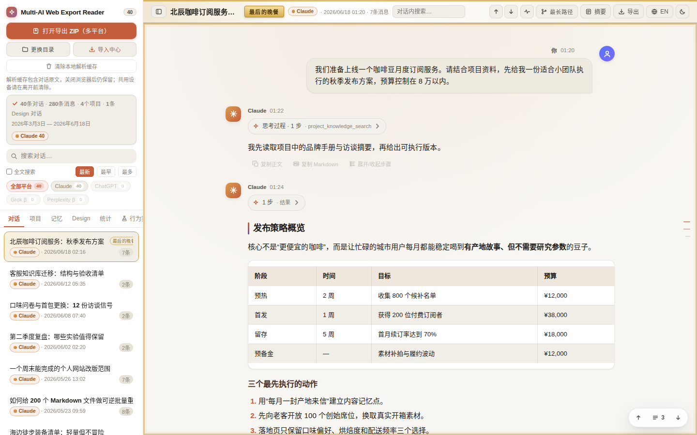
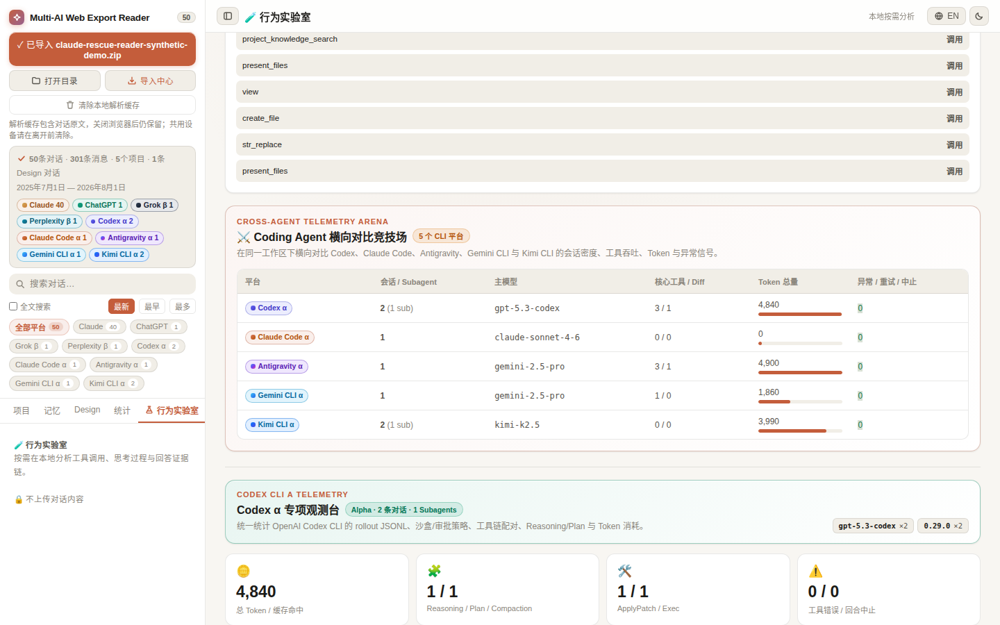

[中文](README.md) | [English](README.en.md)

# Multi-AI Web Export Reader

**Local-Only 9-Platform AI Conversation & Coding Agent Workspace — Web Exports (Claude · ChatGPT · Grok β · Perplexity β) × Coding Agents (Codex α · Claude Code α · Antigravity α · Gemini CLI α · Kimi Code CLI α)**

Turn Web AI export archives and local Coding Agent session logs (ZIP / folders / `.json` / `.jsonl`) into a unified browser-local workspace with shared-cwd CLI merging, bidirectional subagent navigation, Behavior Arena telemetry, full-text search, and privacy-safe redaction.

> 🔒 **Local-only · Zero uploads · No backend**: All parsing, search, analytics, and redaction run inside your browser. Remote images and map tiles are **off by default** (toggleable in Step 1 or the header); the offline bundle works completely without network access.

[](https://github.com/Kisara-Lab/Muti-AI-Web-Export-reader/releases/latest)
[](https://github.com/Kisara-Lab/Muti-AI-Web-Export-reader/actions/workflows/viewer-validation.yml)
[](https://github.com/Kisara-Lab/Muti-AI-Web-Export-reader/actions/workflows/browser-smoke.yml)
[](https://github.com/Kisara-Lab/Muti-AI-Web-Export-reader/actions/workflows/privacy-guard.yml)
[](https://github.com/Kisara-Lab/Muti-AI-Web-Export-reader/releases/latest)
[](LICENSE)

**[⬇ Download `viewer.html`](https://github.com/Kisara-Lab/Muti-AI-Web-Export-reader/releases/latest/download/viewer.html)** · **[🔌 Download offline bundle](https://github.com/Kisara-Lab/Muti-AI-Web-Export-reader/releases/latest/download/claude-rescue-reader-offline.zip)** · **[🧪 Synthetic demo ZIP](docs/demo/claude-rescue-reader-synthetic-demo.zip)** · **[🌐 中文](README.md)**



<sub>Screenshots and the [synthetic demo ZIP](docs/demo/claude-rescue-reader-synthetic-demo.zip) showcase all 9 supported platforms using fictional archives (“Beichen Coffee Subscription” & `beichen-web`); every person, brand, file, and metric is synthetic.</sub>

---

## Supported AI Platforms

Append web archives and local Coding Agent session logs into the **same workspace in any order** — accounts stay isolated per platform, with unified filtering, search, automatic multi-CLI workspace merging, and cross-agent telemetry:

| Platform | Status | Export / Log Path | Supported Formats & Features | Docs |
|---|---|---|---|---|
| **Claude** | Stable | `Settings → Account → Export Data` | Partitioned `manifest-*.json` + ZIPs, legacy ZIP/folder; branches, Thinking states, tool calls, Artifact version history, Projects with 3-layer inference, global/project memories, Design, account & login history | [Partitioned Import Guide](docs/new-export-import.md) |
| **ChatGPT** | Stable | `Settings → Data controls → Export data` | Full ZIP (sharded `conversations-*.json`, `export_manifest.json`) & standalone JSON; branch paths, citations, DIL interactive components, charts, maps, `.dat` local image/Markdown attachments, account metadata | [GPT Support Matrix](docs/gpt-export.md) · [Components](docs/gpt-components.md) |
| **Grok (xAI)** | **Beta Test** | `accounts.x.ai → Data → Download Account Data` | Official export ZIP (`prod-grok-backend.json`, `prod-mc-auth-mgmt-api.json`, `prod-mc-asset-server` assets) & standalone JSON; `leaf_response_id` branches, thinking/tool steps, inline citations, exact Workspace links | Early beta — some evolving fields or media types may be incomplete |
| **Perplexity.ai** | **Beta Test** | `Settings → Account → Export Data` | Official export ZIP (`conversations-*.json`, `user-data-*.xlsx`) & standalone JSON; chained Q&A turns, `user-data` profile/preferences/Spaces workbook | Early beta — official exports omit `[n]` citation URLs; some fields are evolving |
| **OpenAI Codex** | **Alpha** | `~/.codex/sessions/**/rollout-*.jsonl` | Rollout JSONL (`session_meta`, `turn_context`, `apply_patch`, `spawn_agent`, `Plan`, `compacted`); **Codex α Telemetry**, sandbox/approval policies, Reasoning, and bidirectional subagent jumping | Drop `.jsonl` / `.zip` directly onto viewer |
| **Claude Code** | **Alpha** | `~/.claude/projects/**/*.jsonl` | CLI transcripts & Subagent logs; paired tools, cost/git/line-change stats, Hook/Classifier/Compaction telemetry, and parent/subagent jumping | Merges shared `cwd` workspaces automatically |
| **Antigravity** | **Alpha** | `~/.gemini/antigravity/brain/<id>/` | `.system_generated/logs/transcript*.jsonl`, Brain Artifact versions (`.md` / `.resolved.*` + Diff Canvas), Carousels, URL bookmarks, `task_boundary` / `notify_user` cards & `Agent Handoff` | Faithful Artifact Canvas & Brain workspace strip |
| **Gemini CLI** | **Alpha** | `~/.gemini/tmp/<project>/` | `session-*.json` / JSONL, `thoughts`, tool call status badges, `/rewind` / File Patches, `GEMINI.md` memories & per-bucket token breakdown | Maps `.project_root` & `projects.json` paths |
| **Kimi Code CLI** | **Alpha** | `~/.kimi/` & `~/.kimi-code/` | Python Wire 1.x & Node `kimi-code` dual protocols, `context.jsonl` / rotated backups / `subagents/`, dashed `PlanDisplay` cards, Approval / Question / Todo / Shell / Diff, `kimi.log` stub correlation | Strips secrets from `config.toml` & credentials |

> ⚠️ **Alpha / Beta Notice**: **Grok / Perplexity (Beta)** and **5 Coding Agent (Alpha)** parsers evolve alongside upstream export and CLI log schemas; the viewer strictly surfaces observable fields locally without inferring server-side policies.

---

## Start in 30 Seconds

1. **Open the viewer**: Download [`viewer.html`](https://github.com/Kisara-Lab/Muti-AI-Web-Export-reader/releases/latest/download/viewer.html) (or the [offline bundle](#offline-mode)) and open it in Chrome, Edge, or Firefox.
2. **Step 1 · Confirm Privacy & Remote Resources**: Local-only mode is active by default (no external image or OpenStreetMap requests). Enable remote resources in Step 1 or the header if you want ChatGPT remote images/maps loaded.
3. **Step 2 · Import Your Exports**:
   - **Direct ZIP / Folder**: Click **Choose ZIP Archive** or drag & drop one or more ZIPs / extracted folders / `.jsonl` files directly onto the page (**no unzipping required**, append across all 9 platforms anytime).
   - **Claude Partitioned Manifest**: Open **Import Center / Claude Manifest**, load `manifest-*.json`, download packages from Claude, and batch-append the ZIPs.
4. **Explore & Share Safely**: Filter across all 9 platforms, run full-text search, jump between parent & subagent threads, compare Coding Agents side-by-side, or use **Safe Export Markdown / PDF** to redact sensitive data locally.


---

## Core Capabilities

### 💬 Faithful Multi-AI Reading, Branching & Subagent Navigation
- **Unified Timeline & 9-Platform Pills**: Color-coded platform badges and live counts across the sidebar, header metadata, summary drawer, project cards, and analytics overview.
- **Rich Technical Rendering**: Full Markdown (tables, syntax-highlighted code blocks), collapsible **Thinking blocks**, **tool calls & Diffs**, sandboxed Artifact previews (SVG, Mermaid, HTML), ChatGPT DIL interactive widgets, and Antigravity Brain versions/Carousels.
- **Bidirectional Subagent Jumping**: Spawned subagent cards (`spawn_agent`, `Agent`, `Task`, `invoke_subagent`) and the thread header navigation strip jump directly into child subagent threads (`↗ Open subagent`) with a `← Back to parent` breadcrumb.

### 🧭 Projects, Multi-CLI Workspaces & Memories
- **Unified Multi-CLI Workspace Merging**: When 2 or more Coding CLIs (Codex / Claude Code / Antigravity / Gemini CLI / Kimi CLI) operate on the same normalized `cwd`, the viewer automatically merges them into a unified **Multi-CLI Workspace** card with multi-platform pills while preserving single-CLI workspaces independently.
- **Claude 3-Layer Inference & Web Workspaces**: Claude infers project links via **unique project files → knowledge search queries → project-unique memory keywords** with local manual overrides and a reference graph; Grok Workspaces and Perplexity Spaces link directly via official metadata.
- **Memories**: Parses Claude global/project memories, versioned Markdown memory ZIPs, plus `GEMINI.md` / `AGENTS.md` / `kimi.md` engineering memories.

### 📊 Analytics, 🧪 Codex α Telemetry & ⚔️ Coding Agent Arena
- **Coding Agent Behavior Arena**: Compare **Codex, Claude Code, Antigravity, Gemini CLI, and Kimi CLI** side-by-side in **Behavior Lab** on session/subagent density, tool/diff throughput, token volume bars, and failure signals.
- **Per-Agent Telemetry Dashboards**: Dedicated telemetry consoles for **Codex α**, **Claude Code α**, **Antigravity α**, **Gemini CLI α**, and **Kimi Code CLI α** with clickable diagnostic event logs.



### 🛡️ Privacy-Safe Exports (Markdown / PDF / SCP Mode)
- Scans locally for credentials/tokens, emails, phone numbers, IDs, IP/URL tokens, CLI config secrets (`config.toml`), and contextual PII, offering **Standard / Aggressive** modes, consistent aliases, and **SCP Dossier Mode**; see [redaction guide](docs/redaction.md).

---

## Large-Export Performance & Architecture

- **Streaming & Lazy Parsing**: Large JSON files stream in 4 MiB chunks via Transferable `ArrayBuffer`s to a persistent Data Worker; initial load scans top-level metadata only, and messages/highlighting/Mermaid/ZIP assets load lazily on demand.
- **Five On-Demand Workers**: Data, Import, Task, Reader, and Analytics pipelines live in [`src/`](src/) and compile into single-file [`viewer.html`](viewer.html); see [Worker pipelines](docs/worker-pipelines.md).

| Synthetic `conversations.json` | CPU throttle | Initial list | Open a 100-message chat | Full-text search |
|---:|---:|---:|---:|---:|
| 50 MiB | 4× | 0.55 s | 0.65 s | 0.04 s |
| 150 MiB | 6× | 1.69 s | 0.90 s | 0.10 s |
| 300 MiB | 6× | 3.19 s | 1.02 s | 0.23 s |

<sub>Medians of 3 fresh runs on Chromium `150.0.7871.187` with Playwright `1.62.0` (legacy hardcoded field; actual version was not recorded) using synthetic ASCII fixtures generated by [`npm run benchmark:readme`](scripts/benchmark-readme-performance.mjs) ([raw report](docs/benchmarks/readme-performance.json)). Giant single-line exports stalling editors is a known pain point (e.g., [this ClaudeAI thread](https://www.reddit.com/r/ClaudeAI/comments/1oee39d/built_a_tool_to_view_claude_conversation_exports/)).</sub>

---

## Offline Mode

Download [`claude-rescue-reader-offline.zip`](https://github.com/Kisara-Lab/Muti-AI-Web-Export-reader/releases/latest/download/claude-rescue-reader-offline.zip), extract it, and open `viewer.html` while keeping `vendor/` beside it (`marked`, `highlight.js`, `JSZip`, and `mermaid` are bundled for zero-network use).

Build from source (requires Node.js `>= 22.12.0`):

```bash
npm ci
npm run build:offline
```

The offline build is written to `dist/offline/viewer.html`.

---

## Privacy, Storage & Security

- **No telemetry or uploads**: Nothing leaves your browser. External requests occur only if you explicitly enable **Remote media** for ChatGPT images/OpenStreetMap tiles (disabled in the offline bundle).
- **Local parse cache**: Raw conversation text and search indexes are cached in IndexedDB (`claude-rescue-reader-data-v1`) for instant reloads; **use "Clear local parse cache" in the sidebar before leaving shared devices**.
- **Preferences**: Theme (`cv-theme`), language (`cv-lang`), sidebar collapse state, and manual project overrides (`claude-rescue-reader-project-overrides-v1`) stay in `localStorage`.
- **Sandboxed Artifacts**: HTML/SVG previews run in a network-blocked iframe sandbox and never execute inside the main viewer document.

---

## ⌨️ Keyboard Shortcuts

| Shortcut | Action |
|---|---|
| `↑` / `K` | Previous conversation |
| `↓` / `J` | Next conversation |
| `Ctrl+B` / `Cmd+B` | Toggle sidebar |
| `Ctrl+E` / `Cmd+E` | Export current conversation as Markdown |

---

## Development & Community

After editing `src/*.js`, run `node scripts/update-viewer-policy.mjs` to sync `viewer.html`, then verify with `npm run validate`, `npm run privacy`, `npm run docs`, and `npm run test:worker-core`.

- [Contributing guide](CONTRIBUTING.md) · [Code of Conduct](CODE_OF_CONDUCT.md) · [Security policy](SECURITY.md) · [MIT License](LICENSE)

---

## Changelog

- **v2.1 — 9-Platform Consolidation: Coding Agent Arena, Multi-CLI Workspaces & Subagent Navigation**: Completes local CLI support across **OpenAI Codex**, **Claude Code**, **Antigravity**, **Gemini CLI**, and **Kimi Code CLI** (9 platforms total); adds automatic **Multi-CLI Unified Workspace** merging by normalized `cwd`, bidirectional parent/child **Subagent Navigation**, **Codex α Telemetry**, the **Coding Agent Behavior Arena** comparison panel, and an upgraded 9-platform synthetic demo archive.
- **v2.0 — Multi-AI & UI Redesign**: Rebranded to **Multi-AI Web Export Reader**; added full **ChatGPT** support (sharded exports, DIL components, charts, maps, `.dat` attachments) plus **xAI Grok (Beta)** and **Perplexity.ai (Beta)** parsers; introduced **Warm Atelier / Obsidian** themes with built-in offline syntax highlighting, consolidated **Steps timeline**, domain source chips, collapsible sidebar, and floating **Prompt Outline**.

<details>
<summary>Previous Releases (v1.0 – v1.5)</summary>

- **v1.5** *(2026-10-21)*: Claude partitioned `manifest-*.json` exports, standalone memory ZIPs, Artifact version history, and local account/login history.
- **v1.4** *(2026-07-30)*: Expanded image reattachment, explainable safe-export findings, aggressive privacy mode, SCP PDF watermark, and 50/150/300 MiB CPU-throttled benchmarks.
- **v1.3** *(2026-07-29)*: Behavior Lab, persistent Data Worker, project-association explanations & graph, and pre-bundled offline release.
- **v1.2** *(2026-07-28)*: Direct ZIP & drag-and-drop import, branch switching, in-conversation search, Artifact/Mermaid rendering, and precision-first project inference.
- **v1.1** *(2026-07-17)*: Longest-path branch fix, attachment fallbacks, dark theme, full-text search, and sort fixes.
- **v1.0** *(2026-07-16)*: Initial release for viewing Claude export folders.

</details>
