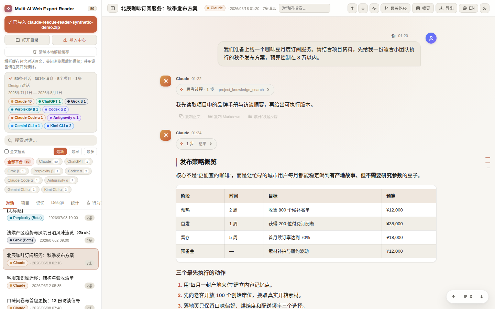
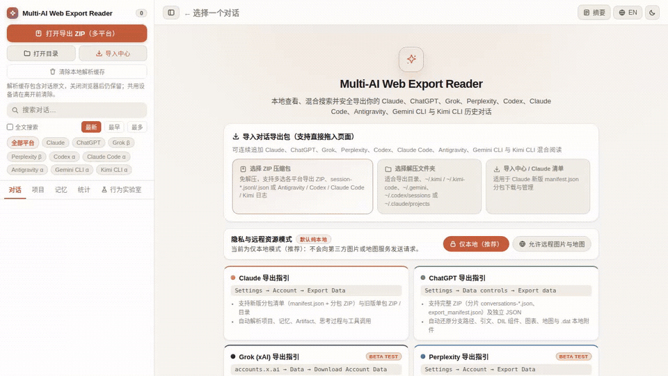
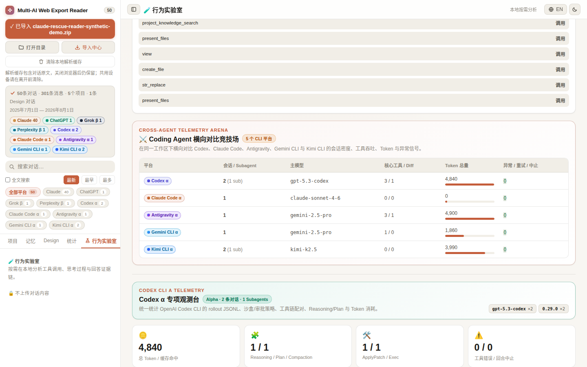

[中文](README.md) | [English](README.en.md)

# Multi-AI Web Export Reader

**纯本地多 AI 对话导出查看器 — 支持 Claude · ChatGPT · Grok (Beta) · Perplexity (Beta)**

把各大 AI 平台导出的 ZIP、解压目录或独立 JSON，在浏览器本机变成可混合阅读、全文搜索、统计分析与隐私脱敏导出的统一工作区。

> 🔒 **纯本地运行 · 零上传 · 零后端**：所有解析、搜索、统计与脱敏都在当前浏览器完成。普通版默认关闭远程图片与地图请求（可在首页第一步或顶部栏一键开启）；完整离线版无需任何网络。

[](https://github.com/Kisara-Lab/Muti-AI-Web-Export-reader/releases/latest)
[](https://github.com/Kisara-Lab/Muti-AI-Web-Export-reader/actions/workflows/viewer-validation.yml)
[](https://github.com/Kisara-Lab/Muti-AI-Web-Export-reader/actions/workflows/browser-smoke.yml)
[](https://github.com/Kisara-Lab/Muti-AI-Web-Export-reader/actions/workflows/privacy-guard.yml)
[](https://github.com/Kisara-Lab/Muti-AI-Web-Export-reader/releases/latest)
[](LICENSE)

**[⬇ 下载单文件版 `viewer.html`](https://github.com/Kisara-Lab/Muti-AI-Web-Export-reader/releases/latest/download/viewer.html)** · **[🔌 下载完整离线版](https://github.com/Kisara-Lab/Muti-AI-Web-Export-reader/releases/latest/download/claude-rescue-reader-offline.zip)** · **[🧪 合成演示 ZIP](docs/demo/claude-rescue-reader-synthetic-demo.zip)** · **[🌐 English](README.en.md)**



<sub>截图与[演示包](docs/demo/claude-rescue-reader-synthetic-demo.zip)覆盖 9 大平台虚构演示历史（以“北辰咖啡订阅服务”与 `beichen-web` 为例）；人物、品牌、文件与数值均为合成演示数据。</sub>

---

## 支持的 AI 平台

支持在同一个工作区**按任意顺序追加导入** Web 导出与本地 Coding Agent 日志，自动隔离账户并按平台筛选、混合搜索、合并同目录 CLI 工作区与对比观测：

| 平台 | 状态 | 导出 / 日志来源 | 支持的格式与解析能力 | 说明 |
|---|---|---|---|---|
| **Claude** | 稳定 | `Settings → Account → Export Data` | 新版 `manifest-*.json` + 分包 ZIP、旧版单包 ZIP / 目录；对话分支、Thinking 状态、工具调用、Artifact 历史版本、项目与三层关联、全局/项目记忆、Design、账户与登录记录 | [新版导入说明](docs/new-export-import.md) |
| **ChatGPT** | 稳定 | `Settings → Data controls → Export data` | 完整 ZIP（分片 `conversations-*.json`、`export_manifest.json`）及独立 JSON；分支路径、引文、DIL 交互组件、图表、地图、`.dat` 本地图片/Markdown 附件、账户信息 | [GPT 支持范围](docs/gpt-export.md) · [组件说明](docs/gpt-components.md) |
| **Grok (xAI)** | **Beta Test** | `accounts.x.ai → Data → Download Account Data` | 官方导出 ZIP（`prod-grok-backend.json`、`prod-mc-auth-mgmt-api.json`、`prod-mc-asset-server` 附件）及独立 JSON；`leaf_response_id` 分支、思考/工具步骤、内联引文、工作区精确关联 | 早期测试中，部分新字段或媒体格式仍在适配 |
| **Perplexity.ai** | **Beta Test** | `Settings → Account → Export Data` | 官方导出 ZIP（`conversations-*.json`、`user-data-*.xlsx`）及独立 JSON；多轮问答链、`user-data` 账户/偏好/Space 工作簿 | 早期测试中，官方正文 `[n]` 引文暂不含 URL，部分字段仍在适配 |
| **OpenAI Codex** | **Alpha** | `~/.codex/sessions/**/rollout-*.jsonl` | rollout JSONL（`session_meta` / `turn_context` / `apply_patch` / `spawn_agent` / `Plan` / `compacted`）；**Codex α Telemetry** 观测、沙盒/审批策略、Reasoning 与子代理双向跳转 | 本地 CLI 日志直接拖拽或打包 ZIP 导入 |
| **Claude Code** | **Alpha** | `~/.claude/projects/**/*.jsonl` | CLI transcript JSONL 与 Subagent 日志；工具链配对、Git/费用/行变更统计、Hook/Classifier/Compaction 遥测与父子代理跳转 | 支持跨 CLI 同路径工作区自动合并 |
| **Antigravity** | **Alpha** | `~/.gemini/antigravity/brain/<id>/` | `.system_generated/logs/transcript*.jsonl`、Brain 工件版本（`.md` / `.resolved.*` + Diff 画布）、Carousels、URL 书签、`task_boundary` / `notify_user` 卡片与 `Agent Handoff` | 完整复刻 Artifact Canvas 与 Brain 工作区条带 |
| **Gemini CLI** | **Alpha** | `~/.gemini/tmp/<project>/` | `session-*.json` / JSONL、`thoughts`、工具调用状态、`/rewind` / File Patch、`GEMINI.md` 记忆与 Token 细粒度统计 | 支持 `.project_root` 与 `projects.json` 映射 |
| **Kimi Code CLI** | **Alpha** | `~/.kimi/` 与 `~/.kimi-code/` | Python Wire 1.x 与 Node `kimi-code` 双代协议、`context.jsonl` / 轮转上下文 / `subagents/`、`PlanDisplay` 虚线卡、Approval / Question / Todo / Shell / Diff、`kimi.log` 存根排障 | 自动剔除 `config.toml` 与凭据文件中的密钥 |

> ⚠️ **Alpha / Beta 说明**：**Grok / Perplexity (Beta)** 与 **5 款 Coding Agent (Alpha)** 解析会随官方或 CLI 日志格式演进而持续迭代；查看器仅基于归档中可观察字段做本地还原与脱敏，不代表后台策略结论。

---

## 30 秒上手

1. **打开查看器**：下载单文件版 [`viewer.html`](https://github.com/Kisara-Lab/Muti-AI-Web-Export-reader/releases/latest/download/viewer.html)（或使用[离线包](#离线模式)），双击用 Chrome / Edge / Firefox 打开。
2. **第一步 · 确认远程资源策略**：首页默认**仅本地模式**（不主动请求任何外部图片或 OpenStreetMap 地图）；如需查看 ChatGPT 导出中的远程图片/底图，可在首页或顶部栏一键开启。
3. **第二步 · 导入或拖入导出包**：
   - **直接导入 ZIP / 文件夹**：点击「选择 ZIP 压缩包」或直接把一个或多个 ZIP / 解压目录 / `.jsonl` 拖入页面（**免解压**，可连续追加 9 大平台任意档案）。
   - **Claude 新版分包清单**：进入「导入中心 / Claude 清单」导入 `manifest-*.json`，在官方页面下载各分包 ZIP 后批量追加。
4. **阅读、搜索与安全分享**：按平台胶囊筛选、全文检索、跳转父子代理对话、对比 Coding Agent 行为竞技场，或使用「安全导出 Markdown / PDF」完成本地隐私脱敏后分享。



---

## 核心功能

### 💬 多平台忠实阅读、分支与子代理跳转
- **统一时间线与 9 平台徽章**：侧栏列表、对话标题栏、项目卡片与统计总览均带独立平台色标与实时计数，支持一键切换全部 9 大平台。
- **富文本与技术块**：完整 Markdown（表格、代码语法高亮 + 一键复制）、可折叠 **Thinking 思考过程**、**工具调用与 Diff 对比**、Artifact 隔离沙箱画布、ChatGPT DIL 组件、Antigravity Brain 工件版本与 Carousel。
- **双向 Subagent 子代理跳转**：主代理生成 `spawn_agent` / `Agent` / `Task` / `invoke_subagent` 的工具卡与顶部导航条可直接跳转至子代理线程（`↗ 查看子代理对话`），子代理顶部提供 `← 返回父会话` 返回面包屑。

### 🧭 项目、多 Agent 统一工作区与记忆重建
- **Multi-CLI 统一工作区合并**：同一本地工程目录（相同标准化 `cwd`）若同时存在 2 个及以上 Coding CLI（Codex / Claude Code / Antigravity / Gemini CLI / Kimi CLI）记录，查看器自动合并为统一工作区卡片（`Multi-CLI Workspace`），汇总所有关联会话与平台胶囊；单 CLI 项目仍保持独立显示。
- **Claude 三层高置信度推断 & Web 工作区**：Claude Projects 支持**唯一项目文件 → 知识搜索词 → 项目记忆独有关键词**三层证据与关系图；Grok Workspaces 与 Perplexity Spaces 支持官方字段精确关联。
- **记忆管理**：支持 Claude 全局/项目记忆、独立 Markdown 记忆 ZIP、以及 `GEMINI.md` / `AGENTS.md` / `kimi.md` 跨会话工程记忆。

### 📊 统计分析、🧪 Codex α 观测台与 ⚔️ Coding Agent 竞技场
- **Coding Agent Behavior Arena**：在「行为实验室」中自动同屏对比 **Codex / Claude Code / Antigravity / Gemini CLI / Kimi CLI** 的会话与子代理密度、工具/Diff 吞吐、Token 总量条与异常/中止信号。
- **专项遥测观测台**：内置 **Codex α**、**Claude Code α**、**Antigravity α**、**Gemini CLI α** 与 **Kimi Code CLI α** 五大专项观测台及可跳转异常事件流。



### 🛡️ 隐私安全导出（Markdown / PDF / SCP 模式）
- 导出前在本地自动扫描密钥/凭据、邮箱、手机号、证件号、IP/URL 令牌、CLI 配置文件密钥（如 `config.toml`）及上下文隐私词，提供**标准 / 强力**两档过滤、一致化名替换与 **SCP 机密档案模式**；[脱敏规则与说明](docs/redaction.md)。

---

## 大型导出性能与架构

- **流式分块与懒解析**：大文件以 4 MiB 分块通过 Transferable `ArrayBuffer` 送入持久 Data Worker；初始导入只扫描顶层元数据，打开对话时才按窗口渲染消息，代码高亮 / Mermaid / ZIP 图片按需加载。
- **五类按需 Worker**：Data、Import、Task、Reader、Analytics 核心逻辑均在 [`src/`](src/) 维护，并通过受控内联同步到单文件 [`viewer.html`](viewer.html)；详见 [Worker 性能管线](docs/worker-pipelines.md)。

| 合成 `conversations.json` | CPU 限速 | 初始列表 | 打开 100 条消息对话 | 全文搜索 |
|---:|---:|---:|---:|---:|
| 50 MiB | 4× | 0.55 秒 | 0.65 秒 | 0.04 秒 |
| 150 MiB | 6× | 1.69 秒 | 0.90 秒 | 0.10 秒 |
| 300 MiB | 6× | 3.19 秒 | 1.02 秒 | 0.23 秒 |

<sub>取 3 次全新浏览器运行中位数（Chromium `150.0.7871.187`、Playwright `1.62.0`（旧脚本硬编码，实际版本未记录）），由 [`npm run benchmark:readme`](scripts/benchmark-readme-performance.mjs) 生成本地合成 ASCII 夹具并实测，[原始报告](docs/benchmarks/readme-performance.json)。单行超大导出曾是社区痛点（如[这条 ClaudeAI 讨论](https://www.reddit.com/r/ClaudeAI/comments/1oee39d/built_a_tool_to_view_claude_conversation_exports/)）。</sub>

---

## 离线模式

下载 [`claude-rescue-reader-offline.zip`](https://github.com/Kisara-Lab/Muti-AI-Web-Export-reader/releases/latest/download/claude-rescue-reader-offline.zip) 并解压，保持 `vendor/` 与 `viewer.html` 位于同一目录即可完全断网运行（已内置 `marked`、`highlight.js`、`JSZip`、`mermaid`）。

从源码构建离线版（需要 Node.js `>= 22.12.0`）：

```bash
npm ci
npm run build:offline
```

构建产物位于 `dist/offline/viewer.html`。

---

## 隐私、本地存储与安全边界

- **无服务器通信**：不会上传对话或统计数据。仅当用户主动点击开启「远程资源」时，浏览器才会按需请求 ChatGPT 导出中的外部图片或 OpenStreetMap 底图；完整离线包已禁用所有外部资源加载。
- **本地解析缓存**：原始对话文本与搜索索引会缓存在本机 IndexedDB（`claude-rescue-reader-data-v1`），以便刷新后秒开；**共用设备离开前请点击侧栏「清除本地解析缓存」**。
- **界面偏好**：主题（`cv-theme`）、语言（`cv-lang`）、侧栏折叠状态与手动项目归属（`claude-rescue-reader-project-overrides-v1`）保存在 `localStorage`。
- **Artifact 安全沙箱**：HTML / SVG 预览运行在禁用联网的隔离沙箱中，不会在主页面上下文执行导入脚本。

---

## ⌨️ 快捷键

| 快捷键 | 功能 |
|---|---|
| `↑` / `K` | 上一条对话 |
| `↓` / `J` | 下一条对话 |
| `Ctrl+B` / `Cmd+B` | 收起 / 展开左侧边栏 |
| `Ctrl+E` / `Cmd+E` | 导出当前对话为 Markdown |

---

## 参与开发与社区

修改 `src/*.js` 后运行 `node scripts/update-viewer-policy.mjs` 同步到 `viewer.html`，并通过 `npm run validate`、`npm run privacy`、`npm run docs` 与 `npm run test:worker-core` 验证。

- [贡献指南](CONTRIBUTING.md) · [社区行为准则](CODE_OF_CONDUCT.md) · [安全策略](SECURITY.md) · [MIT License](LICENSE)

---

## 更新日志

- **v2.1 — 9 大平台大一统：Coding Agent Arena、多 CLI 工作区合并与父子代理跳转**：正式集齐 **OpenAI Codex**、**Claude Code**、**Antigravity**、**Gemini CLI** 与 **Kimi Code CLI** 五大本地 Agent（共 **9 大平台**）；新增同 `cwd` **多 CLI 统一工作区**自动合并、主/子代理对话双向跳转条与工具卡直达按钮、**Codex α Telemetry**、**Coding Agent Behavior Arena** 横向对比面板，并将演示归档升级为 9 平台合一演示包。
- **v2.0 — Multi-AI 与全套阅读体验升级**：更名为 **Multi-AI Web Export Reader**；新增 **ChatGPT** 完整支持（分片、DIL 组件、图表、地图、`.dat` 附件）及 **xAI Grok (Beta)**、**Perplexity.ai (Beta)** 解析支持；推出全新 **Atelier 暖纸 / Obsidian 深色** 双主题与内置离线语法高亮、**Steps 执行时间线**聚合、域名来源胶囊、可折叠侧边栏与悬浮问题大纲。

<details>
<summary>历史版本（v1.0 – v1.5）</summary>

- **v1.5** *(2026-10-21)*：适配 Claude 新版 `manifest-*.json` 分包导出、独立记忆 ZIP 多版本、Artifact 历史版本与账户/登录记录。
- **v1.4** *(2026-07-30)*：增强图片补挂载、可解释脱敏命中细则、强力隐私过滤、SCP 机密 PDF 水印与 50/150/300 MiB CPU 限速基准。
- **v1.3** *(2026-07-29)*：新增行为实验室、持久 Data Worker、项目关联解释与关系图、预打包离线发行版。
- **v1.2** *(2026-07-28)*：新增 ZIP 直读与拖拽、分支切换、对话内搜索、Artifact/Mermaid 渲染与高精度项目归属推断。
- **v1.1** *(2026-07-17)*：修复分支最长路径、附件兜底、暗色主题、全文搜索与排序。
- **v1.0** *(2026-07-16)*：初始版本，支持加载 Claude 导出文件夹并渲染对话。

</details>
