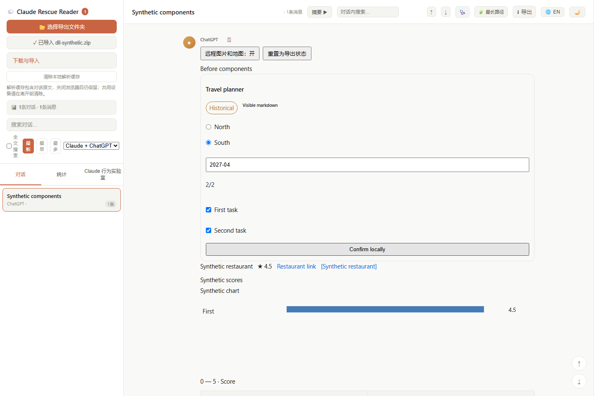
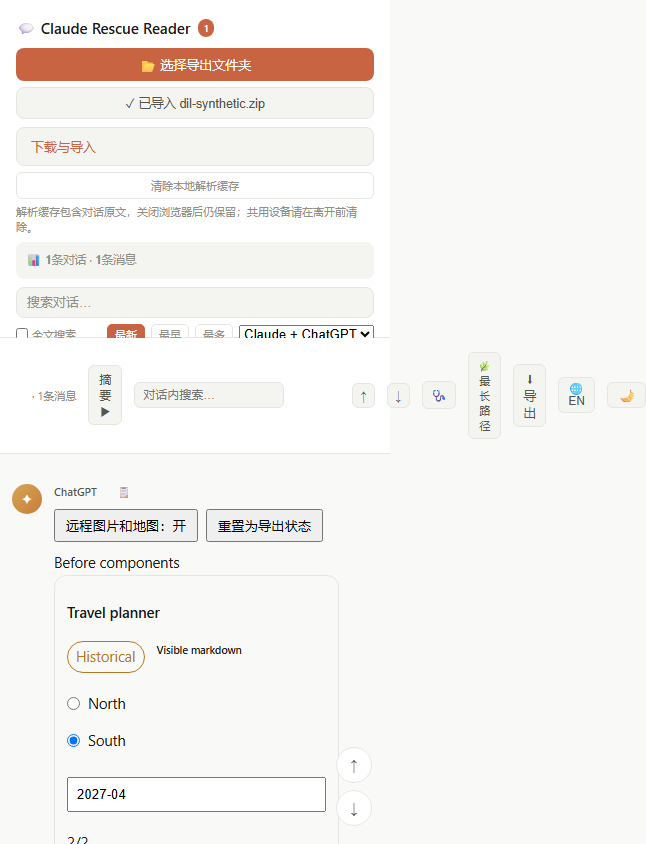

# GPT 正文组件 / Inline components

修复对象是正文 DIL 语法：之前仅处理特殊引用标记，因此将正文中的标签显示成源码或错误地归为“组件数据缺失”。现在布局与正文保持原顺序。Worker 内的受限解释器读取结构和状态，不执行导出 JavaScript。

This repair handles DIL syntax embedded in message text, preserving its position among Markdown blocks. A bounded interpreter reads structure and local state; exported JavaScript never executes.

| 类别 / Category | 组件 / Components | 行为 / Behavior |
|---|---|---|
| 布局 / Layout | `box`, `row`, `grid`, `grid-item`, `divider` | 有界尺寸、间距、边框、圆角、响应布局 / Bounded dimensions, spacing, borders, radius, responsive layout |
| 富文本 / Text | `mark`, `text`, `title`, `caption`, `badge`, `list`, `list-item`, `label`, `icon` | 安全 Markdown 与主题色 / Safe Markdown and theme colors |
| 来源 / Sources | `Cite`, `Entity`, `Link`, `Rating` | 当前消息优先，沿祖先查找；不跨分支猜测 / Current message then ancestors; no cross-branch guessing |
| 数据 / Data | `Chart`, `MapWidgetV2`, `ReservationTimePillsRefWidget` | 柱状图与数据表、分组地点与顺序连线、历史时间与人数 / Bar chart and table, grouped places and order connections, historical times and party size |
| 图片 / Images | `AsyncImage`, `AsyncImageGroup` | 使用明确图片 URL；只有搜索词时保留搜索入口 / Explicit image URLs; query-only exports retain a search link |
| 表单 / Forms | `radio-group`, `radio`, `checkbox`, `input`, `button` | 恢复导出状态、循环清单、进度、本地消息生成与重置 / Exported state, loops, progress, local message generation and reset |

图片和地图在普通版默认联网，资源服务会收到相应请求，工具栏可关闭。地图保留 OpenStreetMap 署名；没有道路数据时连线仅代表顺序，不是道路导航。只有地址时不自动地理编码。完整离线包不加载远程资源。没有图片 URL 时不使用搜索词猜图。

The standard viewer loads remote resources by default and exposes an off switch. Providers receive image or map requests without referrer. OpenStreetMap attribution is retained. Connections indicate order rather than road navigation. Addresses are not automatically geocoded. The complete offline bundle blocks remote resources. Image queries never substitute unrelated pictures.

订位信息始终是历史快照，不能证明实时可订。发送按钮只生成文本，不连接 ChatGPT；上传和拍摄仍不可执行。状态按档案代次、对话和节点隔离，最多保留 32 个组件程序。当前本地表单值进入 Markdown、PDF 和脱敏扫描。安全 PDF 不加载原始图片。

Reservations are historical snapshots, never live availability. Send buttons generate text locally; uploads and camera actions remain unavailable. State is isolated by archive generation, conversation and node, with a 32-program cache. Current local values feed Markdown, PDF and redaction. Safe PDF does not load original images.

## 限制与检查 / Limits and verification

每条正文最多 1 MiB、10,000 个组件节点、64 层嵌套、10,000 次循环展开，解释预算为 100,000 次操作。超限明确提示；原型访问、任意函数、事件代码和 `dil_url` 不执行。导入按消息检查取消，并在约 8 ms 后让出。

Limits per text field: 1 MiB, 10,000 component nodes, nesting depth 64, 10,000 loop iterations and 100,000 interpretation operations. Limits produce diagnostics. Prototype access, arbitrary calls, event code and `dil_url` do not execute. Import checks cancellation between messages and yields after approximately 8 ms.

2026-11-21 授权样本盘点：10 条对话、226 条消息，21 条消息包含组件程序。27 种 DIL 标签均解析无诊断；另 2 种原始扫描标签来自代码或普通内容，不作为可执行组件。已生成 21 组私有浏览器截图；私有报告、正文与截图均仅保存在本地忽略目录。合成截图由 `tests/gpt-dil.spec.mjs` 生成。缺失引用、图片 URL 和订位时间单独记录，不能算作成功恢复。

Authorized sample inventory on 2026-11-21: 10 conversations, 226 messages and 21 component-bearing messages. All 27 actual DIL tag kinds parse without diagnostics; two additional raw tag kinds occur in code or ordinary content. Twenty-one private browser captures are kept only in the ignored local output directory. Synthetic screenshots are generated by `tests/gpt-dil.spec.mjs`. Missing references, image URLs and reservation times are reported separately.

Run `npm run test:worker-core`, `npx playwright test tests/gpt-dil.spec.mjs`, `npm run test:smoke`, `npm run test:offline`, `npm run validate`, `npm run privacy`, `npm run policy` and `npm run docs`. Authorized local archive audits use `node scripts/audit-gpt-components.mjs <export.zip> --browser`; output stays under ignored `dist/private-gpt-audit/`.

最终样本检查：未知组件标签 0、未解析表达式 0、浏览器运行错误 0。仍有 73 个 `Cite` 引用 ID 缺少可精确关联的来源字段；来源列表只有标题与 URL，不能按位置猜测引用。另有 1 个订位组件未导出日期／时间／人数，保留实际入口。只有搜索词的图片展示搜索入口，不计为已恢复图片。这些限制不阻止周围正文和有效组件显示。

Final sample audit: zero unknown component tags, expression diagnostics or browser errors. Seventy-three citation occurrences lack exact source-ID associations; source titles and URLs alone do not establish those associations. One reservation widget lacks exported date/time/party-size data and retains its real provider link. Query-only images expose search links and are not counted as restored images.

以下截图仅使用测试生成的虚构数据，不包含授权档案内容。 / These screenshots contain synthetic data only.

